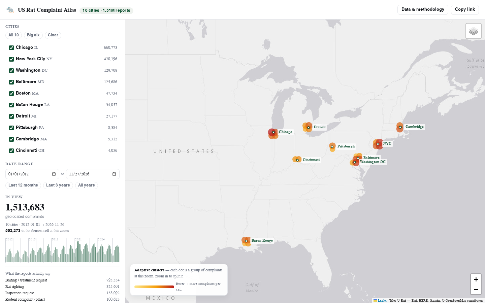

# US Rat Complaint Atlas

An open, interactive map of **rat and rodent complaints from ten US cities**, built entirely from
live municipal 311 open-data APIs — **1,513,683 geolocated complaint records, 2012 → today**.

**Live app:** https://parksiihu7.github.io/us-311-rat-map/



The point of this project is not another dashboard. It is a single, reproducible pipeline that
turns ten incompatible municipal 311 schemas into one research-ready table, ships it as a static
site, and lets anyone slice it by city and date and take the rows away as CSV.

---

## What it does

- **One map, ten cities** — New York, Chicago, Washington DC, Baltimore, Boston, Baton Rouge,
  Detroit, Pittsburgh, Cambridge and Cincinnati. Every dot is a real 311 record with coordinates
  published by the city.
- **Adaptive clustering** — the map aggregates points into screen-space cells at every zoom and
  splits them as you zoom in. It renders 1.5M points on a plain canvas, so there is no
  "too many markers" failure mode.
- **City and date filters** — select any subset of cities, any custom start/end date, and the map,
  statistics and exports all follow.
- **CSV export of exactly the current selection** — `complaint_date, city, state, latitude,
  longitude, standardized_type, original_classification, data_source, source_dataset`.
  Large selections are written in parts so a browser never has to hold a 200 MB blob.
- **Statistics that are honest about the data** — per-city counts, complaint-type mix, monthly
  series, and the density of the densest cell in view.
- **A repeatable fetch** — `scripts/fetch_311.py` re-runs at any time, refetches the current year
  and adds new years automatically.

## Coverage

| City | Records | Missing coords | Coverage | Source |
|---|---:|---:|---|---|
| **Chicago, IL** | 660,773 | 375 | 2012-01-01 → 2026-11-26 | [Chicago Data Portal — 311 Service Requests](https://data.cityofchicago.org/Service-Requests/311-Service-Requests/v6vf-nfxy) |
| **New York City, NY** | 470,796 | 3,143 | 2012-01-01 → 2026-11-25 | [NYC Open Data — 311 Service Requests](https://data.cityofnewyork.us/Social-Services/311-Service-Requests-from-2010-to-Present/erm2-nwe9) |
| **Washington, DC** | 129,708 | 0 | 2013-05-23 → 2026-11-26 | [Open Data DC — 311 City Service Requests](https://opendata.dc.gov/datasets/DCGIS::311-city-service-requests-in-2025) |
| **Baltimore, MD** | 125,686 | 92 | 2012-01-01 → 2026-11-25 | [Open Baltimore — 311 Customer Service Requests](https://data.baltimorecity.gov/datasets/311-customer-service-requests) |
| **Boston, MA** | 47,734 | 441 | 2012-01-02 → 2026-11-10 | [Analyze Boston — 311 Service Requests](https://data.boston.gov/dataset/311-service-requests) |
| **Baton Rouge, LA** | 34,057 | 55 | 2019-02-07 → 2026-11-25 | [Open Data BR — Mosquito and Rodent Service Requests](https://data.brla.gov/resource/bktv-u9ua) |
| **Detroit, MI** | 27,177 | 0 | 2017-06-14 → 2026-11-25 | [City of Detroit Open Data — Improve Detroit Issues](https://data.detroitmi.gov/datasets/improve-detroit-issues) |
| **Pittsburgh, PA** | 8,384 | 81 | 2015-04-30 → 2026-11-24 | [WPRDC — Pittsburgh 311 Data](https://data.wprdc.org/dataset/pittsburgh-311-data) |
| **Cambridge, MA** | 5,312 | 0 | 2013-10-03 → 2026-11-23 | [Cambridge Open Data — Commonwealth Connect](https://data.cambridgema.gov/resource/2z9k-mv9g) |
| **Cincinnati, OH** | 4,056 | 0 | 2012-01-04 → 2026-11-22 | [Cincinnati Open Data — 311 Service Requests](https://data.cincinnati-oh.gov/resource/gcej-gmiw) |

**Total: 1,513,683 geolocated records · 4,187 records excluded for missing coordinates.**

Coverage gaps worth knowing: Boston's 2014 resource is empty in Analyze Boston, so 2014 has no
Boston rows; Washington's rodent code only starts in May 2013; Detroit's Improve Detroit data
begins in June 2017; Baton Rouge's mosquito/rodent system starts in 2019.

Exact per-city filters, field mapping, licences and the list of cities **checked and excluded**
(Seattle, Los Angeles, San Francisco, Philadelphia, Dallas, Nashville, Louisville, Houston and
others have no rodent-specific 311 category) are in [docs/DATA_SOURCES.md](docs/DATA_SOURCES.md).

## The data model

Each record is stored once, in `data/<city>/<year>.json`:

```json
{"year": 2025, "n": 43068,
 "rows": [[9121, 41.88423, -87.63231, 0, 1], ...]}
```

`rows[i]` is `[day, latitude, longitude, type_index, resident_flag]` where `day` is days since
2000-01-01 and `type_index` points into the city's `types` array in `data/manifest.json`. The app
turns each file into typed arrays (`Float32` x/y, `Int32` day, `Uint8` type) the moment it loads,
so 1.5M points cost roughly 17 MB of browser memory.

`data/manifest.json` is the contract: for every city it carries the source name and URL, dataset
IDs, the exact filter used, the source's own definition, the field list, licence, the original
classification vocabulary, per-year record counts, missing-coordinate counts and the real date
range.

### Standardised complaint types

Municipal taxonomies are not comparable, so every record keeps its **original classification**
verbatim and gains a **standardised type**:

`Rat sighting`, `Mouse sighting`, `Signs of rodent activity`, `Dead rodent report`,
`Bite / exposure`, `Infestation report`, `Building infestation report`, `Outdoor sighting`,
`Sewer complaint`, `Food-establishment violation`, `Baiting / treatment request`,
`Inspection request`, `Follow-up inspection`, `Alley concern`, `Housing inspection request`,
`Mosquito + rodent request`, `Rodent complaint (other)`.

## Run it yourself

```bash
python3 scripts/fetch_311.py                  # all cities, 2012 → current year
python3 scripts/fetch_311.py --city nyc chicago --force
python3 scripts/fetch_311.py --manifest-only   # rebuild data/manifest.json only
```

No API keys are needed: every source is a public open-data endpoint. The script writes only files
under `data/` and `scripts/state.json` (per-year counts and coordinate coverage), so re-running it
is safe and incremental — finished years are skipped, the current year is refetched.

The site is plain static files: `index.html`, `app.js`, `style.css`, `data/`. Serve the repository
root with any static file server:

```bash
python3 -m http.server 8000     # then open http://localhost:8000
```

`.github/workflows/refresh.yml` runs the fetch weekly and commits new data, which is the production
refresh path for the live site.

## Methodology and honest limits

- **A complaint is not a rat.** Every record here is a report about a place. Chicago counts
  *requests to bait a location*; New York counts *resident sightings*; Washington counts
  *inspection requests opened by DC Health*. Comparing counts between cities compares reporting
  systems, not rodent populations. The atlas is built for within-city patterns in time and space.
- **Reporting propensity varies** with how a city advertises 311, which department owns rodents,
  and whether residents can report online at all.
- **Coordinates are the city's own**, usually snapped to an address or block; they are not the
  rat's position.
- **Excluded work orders**: Baltimore's scheduled baiting runs (`SW-Rat Rubout Proactive`, about
  95% of rodent rows in that dataset) are city work, not resident reports, and are left out.
  Chicago drops requests flagged `duplicate = true`.
- **Missing coordinates** are counted per city and excluded from the map and CSV; they are 0.28% of
  all rodent records fetched.
- **Precision**: coordinates are rounded to 5 decimals (~1 m) purely for file size.
- **Ordering**: CSV rows are emitted grouped by city and year, not sorted by date.

## Licence

Code: MIT (see [LICENSE](LICENSE)). Data: each city's open-data terms — the source, dataset and
licence for every city is listed in [docs/DATA_SOURCES.md](docs/DATA_SOURCES.md). Basemap tiles:
Esri and OpenStreetMap contributors. Map library: Leaflet.
